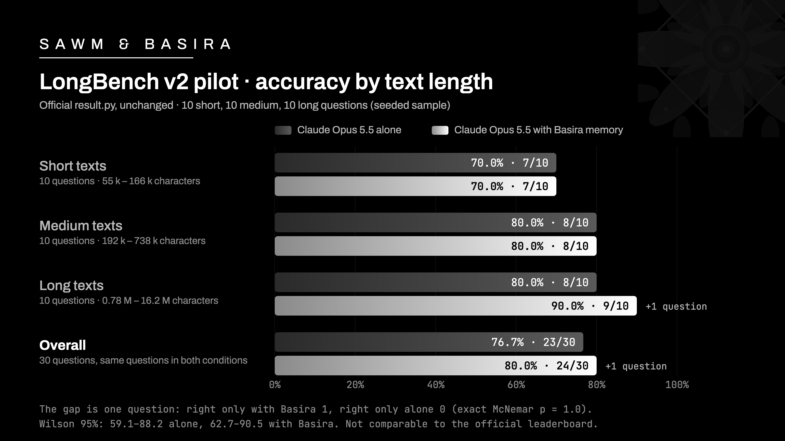
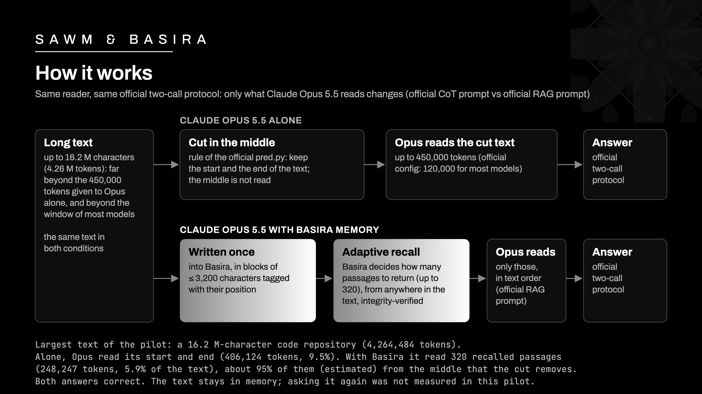
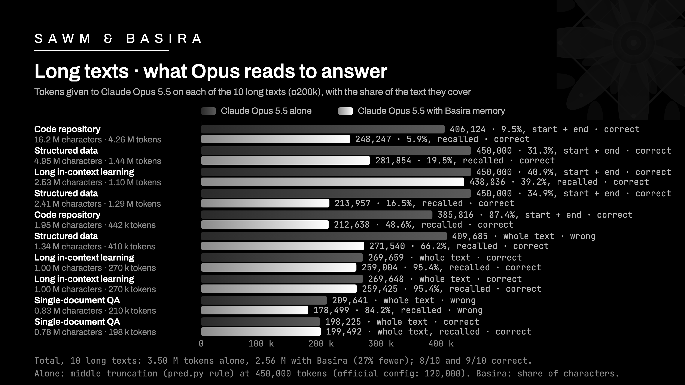

# SAWM & Basira — LongBench v2 pilot: Claude Opus 5.5 with Basira memory

**80.0% with Basira, 76.7% alone**, on a 30-question pilot of LongBench v2, same reader (Claude Opus 5.5), scored
with the official `result.py`. On long texts: **9/10 with Basira against 8/10 alone, while reading 27% fewer
tokens** than Opus alone given up to 450,000 tokens. The difference is one question: this pilot does not establish it
statistically. The full 503-question run is in progress and will be published here.

Every answer is published in the official format, question by question: rerun the official script yourself.



## Results (30 questions, official `result.py`)

| Condition | Overall | Easy | Hard | Short | Medium | Long |
|---|---|---|---|---|---|---|
| Claude Opus 5.5 alone | 76.7 | 100.0 | 69.6 | 70.0 | 80.0 | 80.0 |
| **Claude Opus 5.5 with Basira** | **80.0** | 100.0 | **73.9** | 70.0 | 80.0 | **90.0** |

Same 30 questions in both conditions: 23/30 alone, 24/30 with Basira (easy 7/7 and 7/7, hard 16/23 and 17/23).
Wilson 95% intervals: 59.1–88.2 alone, 62.7–90.5 with Basira. No answer without a letter in either condition.
The output of the official script is in [`official/result.txt`](official/result.txt).

| Domain (questions) | Alone | With Basira |
|---|---|---|
| Single-document QA (11) | 7/11 | 7/11 |
| Long in-context learning (6) | 6/6 | 6/6 |
| Multi-document QA (5) | 3/5 | 3/5 |
| Long structured data (5) | 4/5 | **5/5** |
| Code repository (2) | 2/2 | 2/2 |
| Long dialogue history (1) | 1/1 | 1/1 |

## What Basira adds to the model alone

**1. Draw on the whole text, not only its start and end.** LongBench v2 texts go up to 16.2 M characters (4.26 M
tokens): the largest text of this pilot is that one, a code repository, far beyond the 450,000 tokens given to Opus
alone here, and beyond the context window of most models. Alone, the model has to cut the text: the official protocol
cuts it in the middle and keeps only its start and its end. With Basira, the whole text is written once into memory,
and the passages relevant to the question are recalled from anywhere in it, automatically: with adaptive depth,
Basira decides how many passages to return, up to 320. On short and medium texts it returned the whole document; on 8
of the 10 long texts it returned the maximum of 320 records; on 2 it stopped by itself (252 and 129). On the 5 texts
that had to be cut for Opus alone, about 56% of the passages Basira recalled (785 of 1,399) lie in the middle part
that the cut removes; for the 16.2 M-character repository, about 95% (estimated from the character position of each
passage). On these 5 texts, both conditions answered 5/5: there the gain is tokens (2.14 M → 1.40 M), not accuracy.



**2. Read less, no answer lost on long texts.** On the 10 long texts, Opus with Basira read 2.56 M tokens against
3.50 M for Opus alone (27% fewer, o200k tokenizer, counted on the first-call prompt) and answered one more question
correctly (9/10 against 8/10). This saving is relative to a control reading up to 450,000 tokens: at the official
120,000 cap, Opus alone would read fewer tokens (1.20 M on the 10 long texts), but less of each text. Example: the
16.2 M-character code repository was answered correctly from 5.9% of it (248,247 tokens; Opus alone read 406,124
tokens of its start and end, and was also right). Over the 30 questions: 4.13 M tokens against 5.05 M, 1.22 times
fewer. On short and medium texts Basira returns the whole document, so both conditions read about the same amount
(1.57 M against 1.55 M tokens).

The one question that differs is a structured-data question on a 1.34 M-character table of reviews ("In the given
document, how many DIFFERENT comments talk about "mexican"?"). Opus alone read the whole table (409,685 tokens, not
cut), listed 38 comments and chose 40; Opus with Basira read the 316 passages Basira recalled (320 records returned, 4
of them not starting with a position tag; 66% of the table) and answered 41, the correct answer. Basira's first call
gave the letter without a visible count, and 4 of the 46 blocks mentioning "mexican" were not among the recalled
passages, so this answer cannot be credited to a more complete count. The one extra right answer therefore comes from
a text that Opus alone read whole, not from a text it had to cut.



**3. No answer lost.** There is no question where Opus alone was right and Opus with Basira wrong (0 of 30). 23
questions are right in both conditions, 6 wrong in both.

**4. Every recalled passage comes back intact and verified.** Over the 30 recalls, Basira returned 4,934 passages of
the texts: each one identical to the block written into memory (leading and trailing whitespace aside), each one
marked `integrity_verified` by Basira, none truncated (longest: 3,199 characters, blocks are at most 3,200), none
altered, none dropped to fit a budget. 36 further records, not starting with a position tag (records derived by the
memory itself, quoting a block after a short label), were set aside and counted, as the protocol fixed in advance.
These counts come from the recall records of the run; they are published in `results.json` but cannot be recomputed
from this repository alone.

**5. Memory persists: write once, ask again later.** A text is written once (13,152 blocks, 38.8 M characters for this
pilot) and stays in memory: later questions can recall from it without the text being sent again. This was not
measured in this pilot: each text was asked once; the full run will ask 41 questions on texts already written
(LongBench v2 has 503 questions over 462 distinct texts). Recall took 1.2 to 27 s per question (median about 3 s); the
slowest was the 16.2 M-character repository.

**6. What this adds for model makers and their customers.**

- **Fewer tokens read per answer on long material**: 27% fewer on the long texts of this pilot, with one more right
  answer and no answer lost, relative to a control reading up to 450,000 tokens; at the official 120,000 cap Opus
  alone reads fewer tokens, but less of the text.
- **Recalled evidence that is traceable and verified**: each recalled passage carries its position in the text, the
  time it was written, its source reference and a passed integrity check (in this protocol the reader sees only the
  text, as in the official RAG template).
- **No context-window limit on the amount of material**: the material lives in memory, tested here up to 16.2 M
  characters (4.26 M tokens, more than 9 times the 450,000 tokens given to Opus alone); the window only bounds what is
  read for one question.
- **The model is unchanged**: same model, no fine-tuning; Basira hands it the recalled passages through the official
  retrieval prompt of LongBench v2.

## Read this honestly

- **A pilot of 30 questions** (10 short, 10 medium, 10 long, drawn with a fixed seed; the six domains present, easy
  and hard questions in each length band). The pilot protocol was written and frozen before any recall and any
  scoring. The 30th question (the 16.2 M-character repository) was scored after the other 29, once its writing into
  memory was complete, with no setting changed.
- **The difference is one question.** Exact McNemar test on the paired answers: p = 1.0 (one discordant pair). The
  Wilson intervals overlap widely. This pilot shows no loss and fewer tokens; it does not prove a gain in accuracy.
- **Where the text had to be cut, the gain is tokens, not accuracy.** On the 5 texts cut for Opus alone, both
  conditions answered 5/5; there the gain is tokens (2.14 M → 1.40 M), not accuracy. The one extra right answer came
  from a text that Opus alone read whole.
- **The token saving depends on the control.** It is measured against Opus alone reading up to 450,000 tokens; at the
  official 120,000 cap, Opus alone would read 1.20 M tokens on the 10 long texts (against 2.56 M with Basira), but less
  of each text.
- **On short and medium texts the score measures the model, not the memory.** Basira returned the whole document
  (99.9% to 100% of each text), so nothing the model needed was missing: the same 5 questions are missed in both
  conditions, 4 of them with the same wrong letter. These questions are hard by design: human experts score 47.2% on
  short texts and 53.7% overall (15-minute limit, figures from the LongBench v2 authors).
- **The full run (503 questions) is in progress** and will be published in this repository.
- **Not comparable to the official leaderboard, and no rank is claimed.** The best official entry is Gemini 2.5 Pro,
  63.3% (with CoT; listed with a 1M context). Our protocol differs from the official one (below), the sample is 30
  questions, and the official configuration truncates inputs to 120,000 tokens for most models. These numbers are not
  a LongBench v2 score.
- **Deviations from the official protocol, declared in advance:**
  1. Temperature cannot be set on Claude Opus 5.5 (official: 0.1); Opus always reasons, hence the "w/ CoT" protocol
     (two official calls).
  2. The official `max_new_tokens` (1,024 and 128) are replaced by a cap on the returned text in o200k tokens,
     announced to the model. No first-call output reached 1,024 tokens; 12 final answers (6 per condition) were capped
     at 128, all after the answer letter.
  3. Opus reads through Claude Code sub-agents (Claude Code system prompt), the prompt being read in parts of 12,000
     tokens with the Read tool; one agent per question and per call, no batching.
  4. The "Opus alone" control reads up to 450,000 o200k tokens (middle truncation), instead of the official 120,000
     (200,000 for Claude 3.5 Sonnet): a **stronger** control than the official protocol. For two code repositories
     this cap was lowered to 406,124 and 385,816 tokens to keep the reader's context within budget.
  5. All cuts are counted with the o200k tokenizer, as `pred.py` does for GPT models.
  6. Every transcript was audited (120 tasks: 30 questions × 2 conditions × 2 calls): no context compaction, no
     partial read, no model switch, no tool other than Read. None was rejected.
- **The reader never saw the answers**: the dataset file holding them was kept unreadable from the first read on,
  except during scoring (the first 29 questions were scored before the 30th was read with Basira); recall queries and
  prompts were built from the questions and choices only, and the transcript audit rejects any read outside the
  agent's own prompt files.
- In the second official call, the prompt states that the text is omitted: some final answers therefore mention that
  the passage is not in the prompt. This is the official protocol, identical in both conditions.

The full protocol is in [METHOD.md](METHOD.md).

## LongBench v2 is not a memory benchmark

LongMemEval and LoCoMo measure memory (finding what was said, when, and whether it still holds): Basira scores
98.4–98.6% on LongMemEval-S (official GPT-4o judge) and 96% on LoCoMo (categories 1–4, Mem0 J judge) with Claude
Opus 5.5 ([basira-longmemeval](https://github.com/SAWM-io/basira-longmemeval),
[basira-locomo](https://github.com/SAWM-io/basira-locomo)). LongBench v2 mostly measures understanding and reasoning
over very long documents. In this pilot, memory showed its value in how much the reader has to read on long texts,
not yet in accuracy: on the 5 texts too long to be read whole, both conditions answered 5/5.

## Recount yourself

```sh
python3 -I recount.py    # scores, Wilson, McNemar from the answers; sums of the reading figures

# the official LongBench v2 script, unchanged, on the published answers
mkdir -p results && cp answers/*.jsonl results/ && python3 -I official/result.py && cat result.txt
```

`official/result.txt` is the output of that second command (`result.py` lists the files with `os.listdir`, so on
another system the two rows may come out in the other order). `result.py` names each row after its answer file, so
`official/result.txt` was regenerated with that command once the answer files had their final names: the model names
follow the file names, the scores are unchanged. The reading figures (prompt tokens, shares read, passage counts,
recall times) and the memory figures (integrity checks, identity with the written blocks) are taken from the run
records and published in `results.json`: `recount.py` checks them against the answers and sums them, but cannot
recompute them from this repository alone. The fingerprints of all published files are in [`SHA256SUMS`](SHA256SUMS).

## Files

| File | Content |
|---|---|
| `results.json` | all the numbers above, machine-readable, and the reading figures question by question |
| `answers/opus-5.5-alone_cot.jsonl` | the 30 answers of Claude Opus 5.5 alone (official `pred.py` format) |
| `answers/opus-5.5-with-basira_rag-adaptive_cot.jsonl` | the 30 answers of Claude Opus 5.5 with Basira (official format) |
| `official/result.py`, `official/result.txt` | the official scoring script (unchanged) and its output on `answers/` |
| `recount.py` | offline recount of the scores and sums of the published reading figures, standard library only |
| `METHOD.md` | the protocol |
| `assets/` | the three figures above |
| `NOTICE`, `LICENSE`, `official/LICENSE-LongBench`, `answers/LICENSE-Apache-2.0` | attributions and licences |

## Credits and licences

LongBench v2 is the work of Yushi Bai and co-authors, Tsinghua University (THU-KEG) and Zhipu AI: *LongBench v2:
Towards Deeper Understanding and Reasoning on Realistic Long-context Multitasks* (arXiv:2412.15204),
[github.com/THUDM/LongBench](https://github.com/THUDM/LongBench), [longbench2.github.io](https://longbench2.github.io).
The dataset is under the Apache License 2.0: each line of `answers/*.jsonl` contains, in the fields of the official
`pred.py` output, the question, its choices, its answer, its metadata and the first 1,000 characters of its original
context, in both files (see [`NOTICE`](NOTICE) and `answers/LICENSE-Apache-2.0`). The official code
(`official/result.py`) is under the MIT licence of its authors (`official/LICENSE-LongBench`). The rest of this
repository (texts, figures, `recount.py`, `results.json`, the model's answers) is published by SAWM under the MIT
licence (`LICENSE`).

---

[SAWM](https://sawm.io) · Basira — memory for AI agents.
